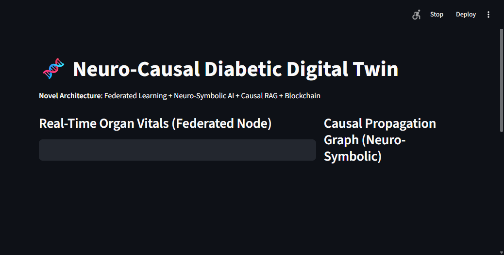
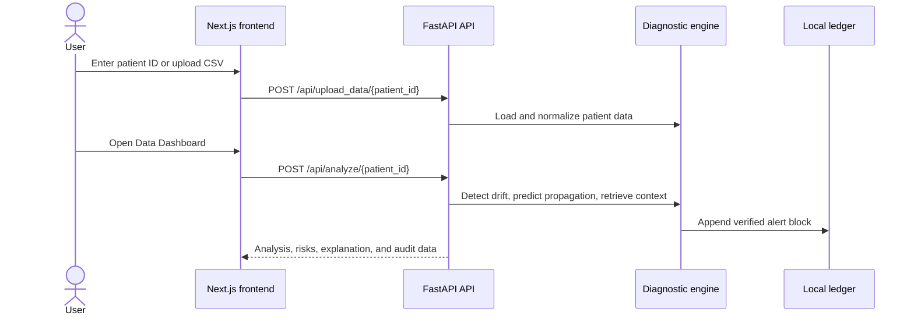
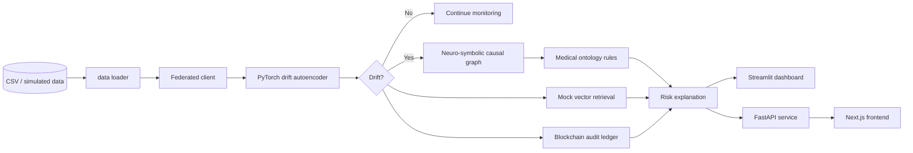
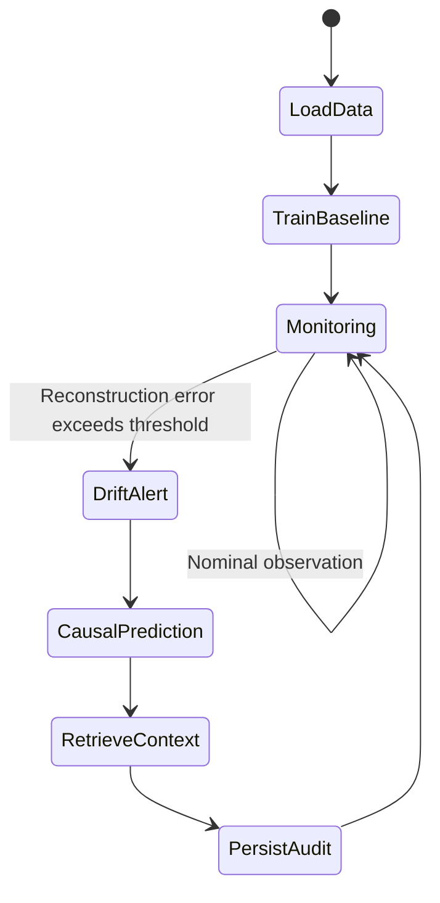
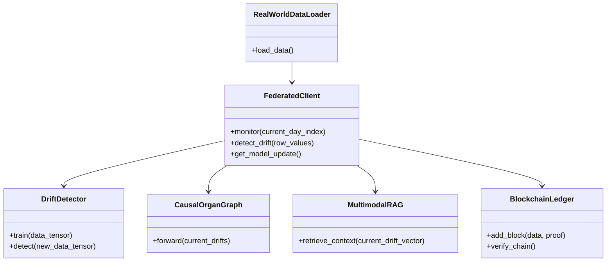

# Neuro-Causal Diabetic Digital Twin

An experimental diabetes-monitoring platform that combines personalized drift detection, federated-learning primitives, neuro-symbolic causal reasoning, retrieval-augmented explanations, and an auditable blockchain ledger.

> **Prototype notice:** This repository is a research/demo prototype, not a medical device. Its predictions, simulated patient data, explanations, and blockchain/ZK components must not be used for diagnosis, treatment, or clinical decision-making.

## Contents

- [What the project does](#what-the-project-does)
- [Highlights](#highlights)
- [Screenshots](#screenshots)
- [Architecture](#architecture)
- [Repository layout](#repository-layout)
- [Prerequisites](#prerequisites)
- [Python setup](#python-setup)
- [Run the Streamlit dashboard](#run-the-streamlit-dashboard)
- [Run the API and Next.js frontend](#run-the-api-and-nextjs-frontend)
- [Run verification and tests](#run-verification-and-tests)
- [Data flow](#data-flow)
- [Configuration and data](#configuration-and-data)
- [API endpoints](#api-endpoints)
- [Design notes and limitations](#design-notes-and-limitations)
- [Development workflow](#development-workflow)

## What the project does

The system models a patient as a continuously monitored digital twin:

1. A CSV dataset is loaded and mapped to the physiological signals used by the prototype.
2. A local autoencoder learns a baseline from an initial training window.
3. New observations are scored using reconstruction error.
4. A drift alert is passed through the causal organ graph.
5. Symbolic medical-ontology rules constrain the learned risk estimates.
6. Similar historical signal patterns and literature snippets are retrieved for context.
7. Alerts are recorded in a persistent local blockchain-style audit trail.

The repository contains two UI surfaces:

- **Streamlit dashboard:** the quickest way to run the end-to-end Python demonstration.
- **Next.js frontend:** a richer patient upload and analytics interface backed by the FastAPI service.

## Highlights

| Capability | Implementation |
| --- | --- |
| Real-world data loading | `data/loader.py` maps Pima-style columns to the prototype's physiological signals |
| Patient simulation | `data/patient_simulator.py` generates baseline data and injects synthetic drift |
| Local drift detection | `models/drift_detector.py` uses a PyTorch autoencoder and a two-sigma threshold |
| Federated-learning primitive | `federated/client.py` trains a local detector and exposes model weights |
| Causal reasoning | `models/propagation_graph.py` combines a neural propagation network with symbolic rules |
| Retrieval-augmented context | `rag/rag_engine.py` retrieves similar cases and seeded literature from an in-memory vector store |
| Audit trail | `blockchain/ledger.py` persists blocks to `blockchain/chain.json` |
| API service | `api/main.py` provides upload, analysis, explanation, WebSocket, and ledger routes |
| Web interface | `frontend/` contains the Next.js/React client |

## Screenshots

### Streamlit monitoring dashboard

The dashboard displays organ-vital trends, the causal propagation area, and the blockchain/RAG result area. Click **Run Simulation Step-by-Step** to advance monitoring.



### Frontend flow

The Next.js interface starts with a patient ID, supports CSV upload, and then requests analysis from the API.



## Architecture



### Monitoring lifecycle



### Core Python modules



## Repository layout

```text
.
├── agents/              Diagnostic orchestration
├── api/                 FastAPI application and request models
├── blockchain/          Local chain, blocks, and simulated ZK proof logic
├── data/                Loaders, simulator, downloader, and sample CSV
├── federated/           Local client/server federation primitives
├── frontend/            Next.js frontend
├── models/              Drift detector and causal graph
├── rag/                 In-memory retrieval-augmented context
├── tests/               Python integration tests
├── dashboard.py         Streamlit application
├── requirements.txt     Python dependencies
└── verify_system.py     Data and ledger smoke verification
```

## Prerequisites

- Python 3.10 or newer
- Node.js 18 or newer and npm (only required for the Next.js frontend)
- Git
- A machine capable of installing PyTorch and its dependencies

The commands below use PowerShell on Windows. On macOS/Linux, replace the activation command with `source .venv/bin/activate`.

## Python setup

From the repository root:

```powershell
python -m venv .venv
.\.venv\Scripts\Activate.ps1
python -m pip install --upgrade pip
python -m pip install -r requirements.txt
```

If PowerShell blocks script activation, use the current process scope:

```powershell
Set-ExecutionPolicy -Scope Process -ExecutionPolicy Bypass
.\.venv\Scripts\Activate.ps1
```

## Run the Streamlit dashboard

The Streamlit dashboard is the recommended first run because it exercises the Python pipeline directly.

```powershell
.\.venv\Scripts\Activate.ps1
streamlit run dashboard.py
```

Open <http://localhost:8501>. Select **Run Simulation Step-by-Step** to advance the monitoring cycle.

The dashboard starts with patient `P001` and loads `data/samples/patient_data.csv`. It shows:

- GFR, retina-thickness, and HRV trends
- Drift-threshold status
- Causal propagation output after an alert
- Blockchain block information
- Similar-case and literature context from the RAG component

## Run the API and Next.js frontend

### Start the FastAPI backend

In a terminal with the Python environment activated:

```powershell
python api/main.py
```

The API listens on <http://localhost:8000>. Interactive API documentation is available at <http://localhost:8000/docs>.

### Start the Next.js frontend

In a second terminal:

```powershell
cd frontend
npm install
npm run dev
```

Open <http://localhost:3000>.

The frontend currently expects the API at `http://localhost:8000`. Start the API before opening the dashboard. Use the patient ID field, optionally upload a CSV, and select **Data Dashboard**.

## Run verification and tests

Run the integration tests:

```powershell
.\.venv\Scripts\Activate.ps1
python -m pytest tests -q
```

Run the data and blockchain smoke verification:

```powershell
python verify_system.py
```

The verification script reads the sample data and writes a test block to `blockchain/chain.json`. If you want a clean demo ledger afterward, restore the JSON file from Git:

```powershell
git restore blockchain/chain.json
```

## Data flow

### Supported sample mapping

`data/loader.py` maps columns from a Pima-style CSV into the signals consumed by the detector:

| Source column | Internal signal | Prototype interpretation |
| --- | --- | --- |
| `Glucose` | `glucose` | Glucose level |
| `BMI` | `gfr` | Kidney-load proxy, scaled by 3 |
| `Age` | `retina_thickness` | Retinal proxy, scaled and offset |
| `BloodPressure` | `hrv` | Heart/HRV proxy |
| `SkinThickness` | `nerve` | Peripheral-nerve proxy |

Missing signals such as `spo2`, `skin_temp`, `eda`, and `activity` are filled from a healthy simulated baseline.

To use a different CSV, place it under `data/samples/` and provide the path through the relevant loader/API flow. The loader expects column names compatible with the mapping above.

## API endpoints

| Method | Endpoint | Purpose |
| --- | --- | --- |
| `POST` | `/api/upload_data/{patient_id}` | Upload patient CSV data |
| `POST` | `/api/analyze/{patient_id}` | Run the analysis pipeline |
| `POST` | `/api/explain` | Request a condition explanation |
| `GET` | `/ledger/chain` | Read the persisted audit chain |
| `WS` | `/ws/{patient_id}` | Receive monitoring updates |

FastAPI's generated OpenAPI documentation at `/docs` is the source of truth for request and response schemas.

## Design notes and limitations

- **Prototype-only clinical semantics:** signal names and organ relationships are illustrative mappings, not validated biomarkers.
- **Synthetic and small data:** the included sample is not a clinical training corpus and should not be interpreted as one.
- **Federated learning is represented, not deployed:** the client exposes local weights, but there is no production aggregation, authentication, or secure transport layer.
- **The vector database is mocked:** `rag/rag_engine.py` uses in-memory arrays and seeded records rather than a persistent embedding service.
- **ZK proofs are simulated:** `blockchain/zk_proof.py` uses hash-based demonstration logic and a hard-coded training key; it is not a cryptographic zero-knowledge system.
- **Blockchain is local JSON persistence:** `blockchain/chain.json` is a demo audit file, not a distributed consensus network.
- **No production security boundary:** do not expose the API publicly without adding authentication, authorization, input validation, rate limiting, secure secret management, and transport security.
- **Randomized output:** some RAG seeds and model behavior are randomized, so exact results can vary between runs.

## Development workflow

1. Activate the Python virtual environment.
2. Make changes in the relevant module.
3. Run `python -m pytest tests -q`.
4. Run `python verify_system.py` when changing data loading or ledger behavior.
5. Start Streamlit or the API/frontend to validate the user-facing flow.
6. Check the working tree with `git diff --check` before committing.

Generated Python caches, virtual environments, Node dependencies, and Next.js build output are excluded by [`.gitignore`](.gitignore).
